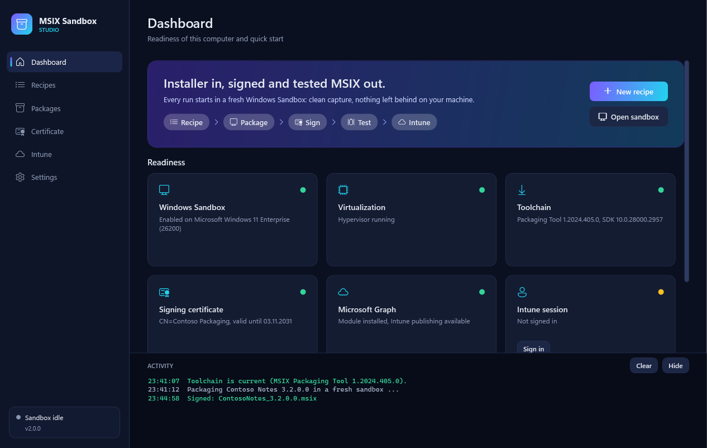
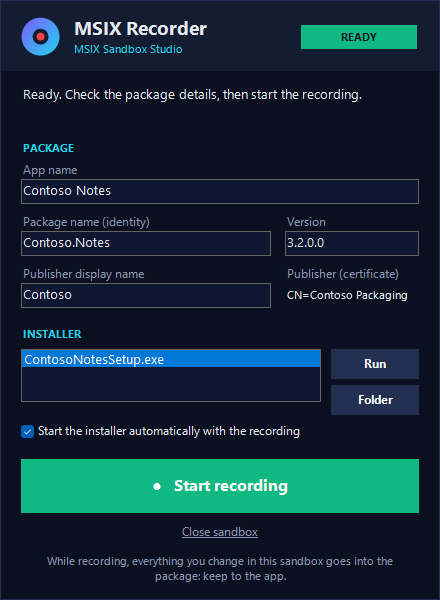

# MSIX Sandbox Studio

Build **signed, tested MSIX packages** and **Win32 apps (.intunewin)** from classic installers, using a fresh
**Windows Sandbox** for every run, and publish them to **Microsoft Intune**. Comes as a
PowerShell module plus a desktop GUI.



## Why a sandbox?

The MSIX Packaging Tool records everything that changes on the machine while an installer runs.
On your own workstation that capture picks up noise, and the installed app stays behind afterwards.
Windows Sandbox gives you a clean Windows image that is thrown away when it closes, so every capture
starts from the same state and nothing is left on the host.

## Features

| Step | What happens |
|------|--------------|
| **Toolchain** | Downloads the MSIX Packaging Tool (offline bundle + license), its driver and the Windows SDK signing tools **once** to the host, with SHA256 hashes. Mapped read-only into every sandbox: no download per run, and it works without network. Checks Microsoft Learn for newer versions. |
| **Recipes** | One JSON recipe per app: installer, silent arguments, package identity. Detects MSI properties and common EXE setup frameworks (Inno Setup, NSIS, WiX Burn, InstallShield, Advanced Installer, Squirrel) and suggests silent arguments. |
| **Package** | Generates a Packaging Tool conversion template and runs the conversion **unattended** in a new sandbox, which closes itself when done. Logs land in the job folder. |
| **Record** | For installers without silent mode, or apps that need setup clicks: the **MSIX Recorder** opens in a sandbox and installs everything by itself. You click **Start recording** (your installer starts automatically), install and configure the app, click **Stop recording**. The package is built, copied back, signed and optionally tested like any other. |
| **Document** | During a recording, **every click** is captured with a screenshot (click marked and numbered, window and button name), and the whole screen is recorded as a frame sequence. Every package gets an **HTML documentation**: identity and signature, automatic steps, all clicks, a screen-recording player, test result, the complete file list and logs. That way it is traceable what is in the MSIX. |
| **Update** | Choose an existing package and click **Update**: when the recording starts, its content is restored in the sandbox (files, registry, Start menu entries). You run the app's updater or the new setup, and the new package contains everything, with a higher version. |
| **Sign** | Signs on the **host** with signtool (SHA256 + RFC 3161 timestamp). The private key never enters a sandbox. |
| **Test** | Installs the package in a second fresh sandbox (certificate trusted, network off), starts every app, takes screenshots and uninstalls it again. |
| **Intune** | Uploads the package as a line-of-business app via Microsoft Graph (new app or new version of an existing one) and assigns it to a group. It can also create the trusted-certificate profile, so devices trust your packages. |
| **Interactive** | Opens a sandbox with the Packaging Tool installed and a shared folder, for apps that need manual steps. |

## Win32 apps (.intunewin)

At start the tool asks what you want to build: **MSIX package** or **Win32 app (.intunewin)**.
Switch at any time with the mode button in the header.

| Step | What happens |
|------|--------------|
| **Design** | Choose the installer. Generated from it: `Install.ps1`, `Uninstall.ps1`, `Detect.ps1` and optionally `Update.ps1`, which runs at the start of the installation, e.g. to remove a previous version or migrate settings. All four can be edited in the tool. Logs go to the Intune Management Extension log folder. |
| **Detection** | Script (`Detect.ps1`), MSI product code (optionally minimum version), file or folder (optionally minimum version), or registry key/value. |
| **Intune settings** | Install behavior (system/user), restart behavior, architecture, minimum Windows version, return codes (0, 1707, 3010, 1641, 1618). |
| **Test lab** | A fresh sandbox opens the **Win32 Test Lab**: **Install**, **Detect**, **Uninstall**, **Detect** with one click each. Commands run as SYSTEM through a scheduled task, like the Intune Management Extension runs them (switchable). Each step shows exit code or detection result and output, and takes a screenshot. If something fails, open the script right there, fix it and run the step again. Edited scripts go back into the project. **Report failure** (with a note) or **Finish: success** ends the session. |
| **Update test** | **Test update from previous build** installs the chosen older build first, detects it, then installs the new version over it, detects it, uninstalls and detects again. So the update path is tested exactly. |
| **Build** | Creates the `.intunewin` in the format of the Microsoft Win32 Content Prep Tool, without needing the tool. Next to it: **`intune-app.json`**, the parameter file with every Intune setting, the Graph detection rule, hashes and the test result. Also the HTML documentation: settings, test protocol with every step and screenshot, documented clicks, all scripts, package content. |
| **Publish wizard** | 1. app details, 2. the Intune app this one **supersedes** (search the tenant; *update* installs over it, *replace* uninstalls it first), 3. group and intent, 4. summary, then upload. |

PowerShell equivalent:

```powershell
$app = Save-Win32AppProject -DisplayName 'Contoso Tool' -Publisher Contoso -Version 2.4.1 `
    -InstallerPath C:\Installers\contoso-setup.exe -InstallArguments '/S' -WithUpdateScript
Start-Win32TestLab -Id $app.Id                                    # new installation
Start-Win32TestLab -Id $app.Id -BaseBuild .\Workspace\Output\Win32\ContosoTool_2.3.0   # update test
$build = New-Win32AppPackage -Id $app.Id                          # .intunewin + intune-app.json + documentation
Publish-Win32AppToIntune -BuildPath $build.BuildPath -SupersedeAppId <old-app-id> -SupersedenceType update -GroupId <group-id>
```

## Requirements

- Windows 10/11 Pro, Enterprise or Education with virtualization enabled
- Windows Sandbox feature enabled (the dashboard can do this for you; needs a reboot)
- Windows PowerShell 5.1 (included in Windows) or PowerShell 7
- For Intune: `Install-Module Microsoft.Graph.Authentication -Scope CurrentUser`, an account allowed to manage Intune apps
- Optional, for certificates from Azure Key Vault: `Install-Module Az.KeyVault -Scope CurrentUser`

## Quick start (GUI)

1. Double-click **`Start.cmd`**.
2. **Dashboard**: fix anything that is not green. The toolchain downloads on first use (about 60 MB).
3. **Certificate**: create a self-signed code-signing certificate, or import a PFX from your CA or Key Vault.
   Its subject (for example `CN=Contoso Packaging`) becomes the publisher of every package.
4. **Recipes**: drop an `.msi` or `.exe` on the window, check the suggested values and click
   **Package + sign + test**.
   To install by hand instead, see [Recording an installation](#recording-an-installation).
5. **Packages**: see the test result and screenshots, open the **Documentation**, then click **Publish to Intune**.

Sign-ins (Intune, Azure Key Vault) open the Microsoft sign-in in front of the tool; there is no
second console window. Look and behavior are the same as in the M365 MFA Administration tool.

### Sign in with Keevault

The arrow next to **Sign in** offers a second way: **Sign in with Keevault**. The tool connects to
[Keevault](https://keevault.de) through its MCP interface (tool `request_microsoft_login`):

1. Keevault comes to the front, you allow *MSIX Sandbox Studio* (first time only) and pick the Microsoft account.
2. An embedded sign-in window (WebView2) opens the normal Microsoft sign-in. User name, password and the
   current one-time code are filled in step by step; if the code has expired, a fresh one is fetched from
   Keevault (`get_totp`). You can type yourself or pick another method (e.g. passkey) at any time.
3. The token is renewed automatically before it expires (refresh token, kept in memory only).

Requirements in Keevault (0.9.22 or later): *Settings > AI agents (MCP)* switched on, *Microsoft sign-ins for tools*
allowed under *Additional rights*, and the account in a vault or folder released for AI agents. Keevault must
be running and unlocked. The WebView2 SDK (about 1 MB of DLLs, signed by Microsoft) is downloaded from NuGet on
first use into `Workspace\Toolchain\WebView2`; the WebView2 runtime is part of Windows 11.

Devices must trust the signing certificate. With a self-signed one, click **Trust via Intune**
on the Certificate page once and assign the profile to the same devices.

## Recording an installation

For setups without silent mode, or when you want to click through the installer and configure the app:

1. Click **Record installation** on the dashboard. A dialog asks first:
   - **Starting point**: a clean sandbox, an **existing MSIX package** or an **existing Win32 app (.intunewin)**
     that is put in place first (see [Updating an existing package](#updating-an-existing-package)).
   - **Installer to record** (with a starting point: the **update to install**), and whether it starts
     automatically. Leave it empty to download the installer or run the app's own updater in the sandbox.

   Alternatively, choose **Manual (record my installation)** in a recipe and click **Record + sign**.
2. A sandbox opens with the **MSIX Recorder**. It installs the Packaging Tool driver, the tool and your signing
   certificate by itself and shows the progress. Check the package details meanwhile.
3. Click **Start recording**. The recording starts and your installer launches automatically.
   The recorder shrinks to a small bar with a timer.
4. Install and configure the app. **Run** starts the installer again if needed.
5. Click **Stop recording**. The Packaging Tool builds the package, the sandbox closes, and the host signs it.
   The values you used are saved as a manual recipe for the next version.

| Ready | While recording |
|-------|-----------------|
|  |  |

Everything you change in the sandbox while recording goes into the package, so keep to the app.

### Documentation

While recording, the recorder captures every left and right click with a screenshot taken just before
the click (the click is marked and numbered), plus the window title, the program and the name of the
clicked element (UI Automation). The screen is also saved once per second. Clicks on the recorder itself
are left out. After the build, `<package>_documentation\index.html` is written next to the package.
It contains:

- package identity, capabilities, signature, installer with SHA256, how the package was made
- the automatic preparation steps in the sandbox
- every click as a numbered step with screenshot
- a player for the screen recording, with the clicks marked on the timeline
- the test result with screenshots (after **Test**)
- the complete file list of the package, grouped by location, and the packaging logs

Switch it off with the checkbox in the recorder if you do not need it. Silent packages get the same
report, without clicks.

### Updating an existing package

1. On **Packages**, choose the package and click **Update (record new version)**: the record dialog opens with
   this package as starting point. Optionally pick the update installer; leave it empty if the app updates itself.
2. The recorder shows the base package. The version is already raised by one.
3. **Start recording**: the old package is restored first, as a classic installation inside the capture
   (files to their real folders, registry imported, Start menu entries). Then the update installer starts,
   or you start the app and run its updater.
4. **Stop recording**: the new package contains the old content plus every change of the update.

For the update to replace the old version on devices, it must be signed by the same publisher
(certificate subject) as the base package. The tool warns if it is not.

**From a Win32 app:** choose *Existing Win32 app (.intunewin)* in the record dialog. The `.intunewin` is decrypted
on the host; the install command comes from the `intune-app.json` next to it (builds of this tool) or is derived
from the setup file (`.msi` silent, `.ps1` via PowerShell, `.exe` as is: add its silent arguments). After
**Start recording** it is installed inside the capture (exit codes 0, 1707, 3010, 1641 count as success), then
the update runs. The result is an MSIX with the app and the update.

## Quick start (PowerShell)

```powershell
Import-Module .\MsixSandboxStudio\MsixSandboxStudio.psd1

Update-MsixToolchain
New-MsixCertificate -Subject 'CN=Contoso Packaging' -Password (Read-Host -AsSecureString 'PFX password')

Get-MsixInstallerInfo C:\Installers\notes-setup.exe          # suggests name, version, silent arguments
Save-MsixRecipe -InstallerPath C:\Installers\notes-setup.exe -PackageName Contoso.Notes `
    -DisplayName 'Contoso Notes' -Version 3.2.0 -Arguments '/VERYSILENT /NORESTART'

# Package -> sign -> test -> publish, stops at the first failing step
Connect-MsixIntune
Invoke-MsixPipeline -RecipeName Contoso.Notes -Publish -GroupId <entra-group-id> -Intent required
```

Single steps: `Invoke-MsixPackaging`, `Start-MsixRecording` (MSIX Recorder; `-BasePackage` for updates),
`Invoke-MsixSigning`, `Test-MsixPackage`, `New-MsixDocumentation`, `Publish-MsixToIntune`,
`Publish-MsixCertificateToIntune`, `Start-MsixSandbox` (interactive). `Get-Help <command>` describes each.

## How it works

```
Host                                          Windows Sandbox (fresh every run)
--------------------------------------------  -------------------------------------------
Workspace\Jobs\<job>\  ──(mapped, writable)──▶ C:\MsixStudio\Job         job.json, template.xml,
                                                                         input\, out\, status.json
Workspace\Toolchain\   ──(mapped, read-only)─▶ C:\MsixStudio\Toolchain   Packaging Tool, driver
MsixSandboxStudio\Sandbox\ ─(read-only)──────▶ C:\MsixStudio\Tools       Bootstrap.ps1 (logon command)
```

1. The host writes a job folder (`job.json`, conversion template, installer copy) and a `.wsb` file.
2. Windows Sandbox starts and runs `Bootstrap.ps1` as logon command. It installs what the job needs,
   does the work and reports progress in `status.json`. For recordings, `Recorder.ps1` takes over once the
   tool is installed. On **Start recording** it runs the Packaging Tool with a template whose "installer"
   is `RecordingHold.ps1`. That process starts your setup and waits. **Stop recording** signals it through a
   named event, it exits, and the tool builds the package.
   Logs and the documentation are kept in `%TEMP%` (excluded from captures) during the run and copied to
   `out\` at the end. Windows services in the sandbox (app deployment, the Packaging Tool) cannot read
   mapped folders, so the sandbox first copies the job input to `C:\MsixStudioLocal` and works there.
3. The host follows `status.json`, picks up the results from `out\` and continues
   (signing, the next test or upload). Package and test sandboxes shut themselves down.

Everything local lives in `Workspace\` (gitignored): `Toolchain`, `Certificates`, `Recipes`,
`Jobs` (one folder per run, with logs and screenshots), `Output` (signed packages) and `Shared`
(mapped into the interactive sandbox). Settings are stored in `settings.json`.

## Security notes

- The PFX and its password stay on the host. The password is stored with DPAPI
  (`*.pwd`, readable only by your Windows account on this computer). Sandboxes only receive the public `.cer`.
- `*.pfx`, `*.pwd` and the workspace are gitignored. Never commit signing keys.
- The certificate that was committed to this repository before version 2.0 is public.
  Do not trust it on any device; create your own instead.
- The test sandbox runs without network access.
- Keevault sign-in: credentials go only to Microsoft's sign-in pages (`login.microsoftonline.com`,
  `login.microsoft.com`, `login.live.com`); each value is filled in once, a rejected password is not retried.
  The embedded browser uses a temporary profile that is deleted afterwards. Nothing is stored on disk.
- The documentation shows the screen as it was during the recording: license keys or credentials typed
  into a setup can be visible in screenshots. Check the report before sharing it, or switch the
  documentation off in the recorder for such installs. Keystrokes themselves are not recorded.

## Limitations

- Windows runs only one sandbox at a time, so jobs run one after another.
- Manual recording captures everything changed in the sandbox while the recording window is open,
  so keep to the app (no browsing around or unrelated installs).
- Intune upload covers single `.msix` packages (no bundles or dependencies yet).
- Assigning an app replaces its existing assignments.

## Tests

```powershell
Invoke-Pester .\Tests      # Pester 5; offline, no sandbox or tenant needed
```

## Classic script

`install.ps1` is the original one-shot script. Run it inside a manually started sandbox to install
the Packaging Tool and optionally create a certificate. MSIX Sandbox Studio replaces it, but it is
kept so that existing links keep working.
